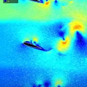
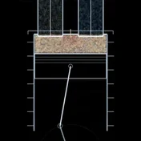
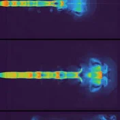
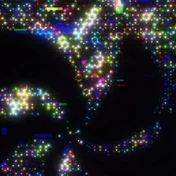
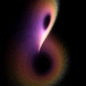
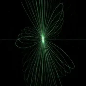
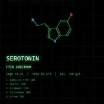
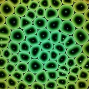
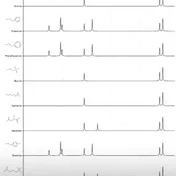

# spectrometry.mp4

Simulation engines and video scenes by Clancy. Explore fluid flow, electric fields, orbitals, molecules, and cell colonies through code.


## Find the engine behind a video

Select an engine to open its guide. The [video recipes](docs/render-recipes.md) list scene names, render commands, and any media you need to supply.

<table>
<tr>
<td align="center"><a href="engines/wind-tunnel/README.md"><br><strong>Wind Tunnel</strong></a></td>
<td align="center"><a href="engines/field-lines/README.md"><br><strong>Field Lines</strong></a></td>
<td align="center"><a href="engines/gas-lab/README.md"><br><strong>Gas Lab</strong></a></td>
<td align="center"><a href="engines/plume-lab/README.md"><br><strong>Plume Lab</strong></a></td>
</tr>
<tr>
<td align="center"><a href="engines/lattice-grid/README.md"><br><strong>Lattice Grid</strong></a></td>
<td align="center"><a href="engines/shape-physics/README.md"><br><strong>Shape Physics</strong></a></td>
<td align="center"><a href="engines/attractors/README.md"><br><strong>Attractors</strong></a></td>
<td align="center"><a href="engines/orbital-lab/README.md"><br><strong>Orbital Lab</strong></a></td>
</tr>
<tr>
<td align="center"><a href="engines/oscilloscope/README.md"><br><strong>Oscilloscope</strong></a></td>
<td align="center"><a href="engines/chemical-scope/README.md"><br><strong>Chemical Scope</strong></a></td>
<td align="center"><a href="engines/bio-lab/README.md"><br><strong>Bio Lab</strong></a></td>
<td align="center"><a href="engines/academia/README.md"><br><strong>Academia</strong></a></td>
</tr>
</table>

For the standalone Manim scene, see [Chemical Profiles](chemical_profiles/README.md).

## Render your first scene

Install Python 3.10 or newer and add ffmpeg to your PATH. Clone the repository and create a virtual environment:

```sh
git clone https://github.com/ec175/spectrometry_public.git
cd spectrometry_public
python -m venv .venv
```

Activate it with `.venv\Scripts\Activate.ps1` in PowerShell or `source .venv/bin/activate` on macOS or Linux. Then render a Wind Tunnel preview:

```sh
cd engines/wind-tunnel/src
python -m pip install -r requirements.txt
python cli.py tri_foil_air_fast --preview
```

The MP4 goes in the engine's `out/` folder. Use a separate environment for each engine. The [engine index](engines/README.md) links to the other guides.

## Reuse and credit

The code is available under the [MIT license](LICENSE). Keep the copyright and license notice with copies of the code. If you share a video or project made with these engines, please credit **spectrometry.mp4 by Clancy** and link to this repository. See [CITATION.cff](CITATION.cff) for a formal citation.

See [repository checks](docs/repository-checks.md) if you're contributing. If a render fails, [open an issue](https://github.com/ec175/spectrometry_public/issues/new?template=bug.yml) with the command and error.

[Website](https://ec175.github.io/spectrometry_public/) · [Instagram](https://instagram.com/spectrometry.mp4) · [YouTube](https://www.youtube.com/channel/UChtdNI2BC1SmkmHEERA4dzg)
