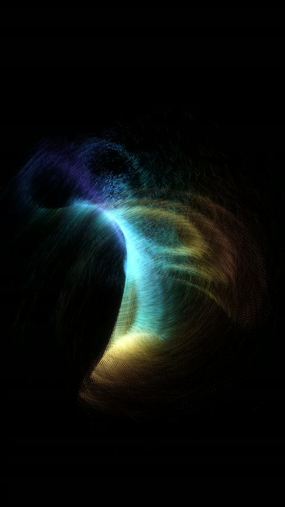
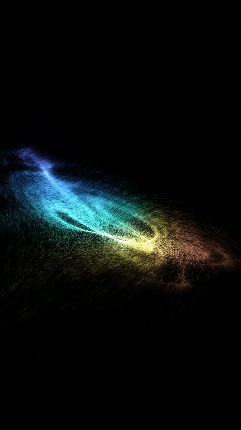
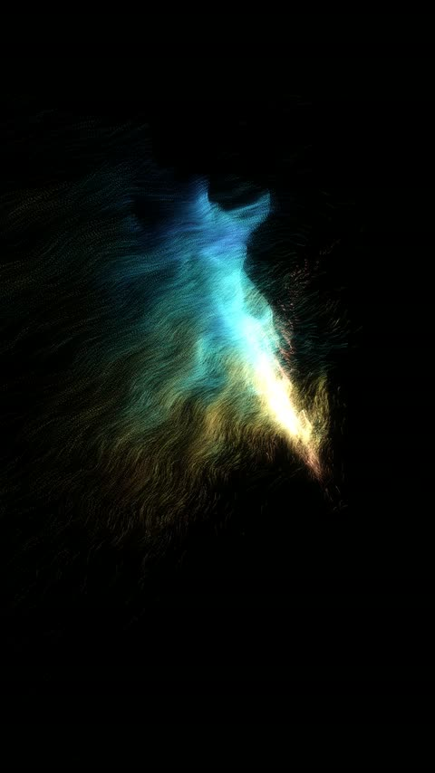
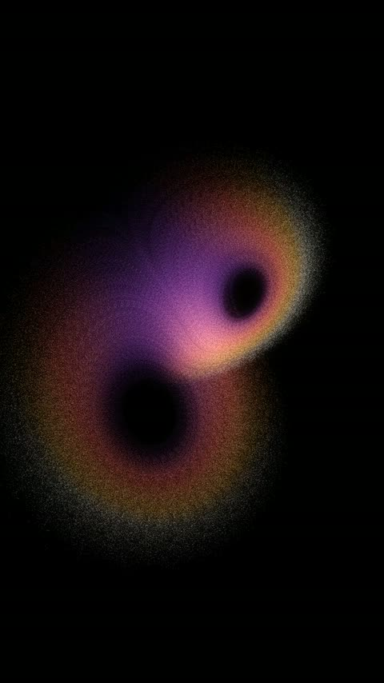

<div align="center">


# Attractors

**Chaos, drawn by tens of thousands of particles.**

[← All engines](../README.md) · [What it can make](CATALOG.md) · [Stills](frames/README.md) · [Source](src/)

</div>

**Tens of thousands of particles integrated through a strange-attractor flow at once.** Nothing is
traced — the picture is built entirely by where particles crowd.

<p align="center">
<a href="frames/attractor_tour_t030.jpg"></a>
<a href="frames/attractor_tour_t052.jpg"></a>
<a href="frames/attractor_tour_t074.jpg"></a>
<a href="frames/lorenz_swarm_t055.jpg"></a>
</p>

## Start here

From the repo root, inside a virtual environment:

```bash
pip install -r engines/attractors/src/requirements.txt   # numpy + Pillow
```

```python
import sys; sys.path.insert(0, "engines/attractors/src")
from at import core, draw

print("flows:   ", sorted(core.FLOWS))
print("palettes:", sorted(draw.PALETTES))

s = core.Swarm("lorenz", n=42000, seed=1)
s.step(1 / 60.)
print(f"{s.P.shape[0]} particles, mean speed {s.speed().mean():.1f}")
```

That builds a 42,000-particle swarm on the Lorenz attractor and advances it one frame. RK4 on an
`(N, 3)` array costs the same four function calls as RK4 on one point, so the particles are
essentially free next to the rasteriser.

When you draw it, `core.project` returns a 2-D position **and a depth**. Use the depth: with
40,000 additive points, a purely flat projection turns a 3-D object into a smear, while a weak
perspective divide plus depth-keyed size and brightness is enough to separate the front and back
lobes.

## Render a video

All five compositions are in `src/at/scenes.py`:

```bash
cd engines/attractors/src
python cli.py list
python cli.py lorenz_swarm --still 3,8,14 --preview   # PNGs, no video
python cli.py lorenz_swarm --preview                  # 540x960 @30
python cli.py lorenz_swarm                            # 1080x1920 @60 -> out/lorenz_swarm.mp4
```

Point it at ffmpeg with `AT_FFMPEG` if it isn't on your PATH, and set `AT_NVENC=0` to force CPU
encoding.

## Why a swarm and not an orbit

A single trajectory shows you the **shape** of an attractor. A swarm shows you its **invariant
measure** — which parts of that shape the system actually spends its time in,

$$
\mu(A)\;=\;\lim_{T\to\infty}\frac{1}{T}\int_{0}^{T}\mathbf{1}_{A}\big(\mathbf{x}(t)\big)\,dt
$$

which the renderer approximates by histogramming the swarm onto the raster. So the bright regions
in these clips are not artistic emphasis — brightness *is* occupancy, and it is where the dynamics
dwell. (For the Lorenz flow, $\dot{x}=\sigma(y-x)$, $\dot{y}=x(\rho-z)-y$, $\dot{z}=xy-\beta z$.)

That is a different measurement, not a restyling, and it is cheap: RK4 on an `(N,3)` array costs
the same four function evaluations as RK4 on one point, so 40,000 particles are essentially free
next to the rasteriser.

**Colour always encodes a real quantity** — speed, drift, distance from the manifold, age. That is
the rule that keeps this a visualisation rather than a screensaver, and it is also what makes the
pictures legible: every palette is built monotone in luminance, so a viewer can read "more" from
"brighter" without a legend.

## Two things that are easy to get wrong

**Seeding.** Particles started in a random ball are all *off* the attractor, and their approach
transients are long, bright and identical-looking — the first second of the clip becomes a
collapsing shell that has nothing to do with the dynamics. Seed **along a reference orbit** with a
little scatter instead, which puts every particle on the attractor from frame zero.

(The one composition that deliberately does the opposite is the point of that composition: seed
40,000 particles in a big uniform box and watch a structureless cloud collapse onto a
two-dimensional sheet in about four seconds, because the flow contracts volume everywhere.)

**Recycling.** Chaotic flows are volume-*contracting*, so an un-recycled swarm collapses onto a
thin filament within a few seconds and the picture loses every part of the attractor the
trajectory is not on right now. Respawning a few percent per second back onto the reference orbit
keeps the whole invariant measure lit.

## Six flows, and how to add one

`FLOWS` maps a name to a function, a suggested timestep, a seed point and a display span. Adding
one is a vectorised `f(P) -> dP/dt` plus a row in that dict — nothing else changes.

| flow | dt | what it looks like |
|---|---|---|
| `lorenz` | 0.0045 | the butterfly — two lobes with a slow crawl through the middle |
| `rossler` | 0.0180 | a single spiral band with a periodic fold out of plane |
| `aizawa` | 0.0095 | a torus-like shell with a spike through its axis — the most three-dimensional |
| `halvorsen` | 0.0058 | three-fold symmetric, knotted |
| `thomas` | 0.0420 | cyclically symmetric, built from sines — loops rather than lobes |
| `chen` | 0.0040 | a double-scroll relative of Lorenz with a broader sweep |

## The morph, which is the one non-obvious trick

To show four attractors as **one object**, interpolate the **derivative**, not the picture:

```
dP/dt = (1-u)·f_A(P) + u·f_B(P)
```

Because the blend is of the vector *fields*, every intermediate is a real dynamical system with
its own trajectories. The swarm is never teleported and never cross-faded — watching a Lorenz
butterfly stretch into a Halvorsen knot through a sequence of attractors nobody has named is the
whole reason to do it that way.

Two details it needs: **normalise each field to a common speed** before blending, or the transit
either stalls or explodes as one system's characteristic rate dominates; and **renormalise the
view on the LIVE swarm**, because the tour leaves the seed attractor's bounding box entirely.

Also: **the spin must be faster than the morph.** A morph slower than the view rotation reads as a
still object being turned, not as one system becoming another.

## Exposure

The one place this format blows out is where the swarm *concentrates*. A collapse onto a 2-D sheet
saturates the additive buffer and the core goes flat white — losing exactly the structure the
collapse was meant to show. Lower both exposure and per-point gain for those compositions rather
than trying to fix it afterwards.

## Orientation

`project` returns normalised coordinates and `Canvas` decides the frame, so nothing in the
dynamics knows the aspect ratio. A landscape plate is a different `Canvas` size and nothing else.

## What is not here

- **Frames for `lorenz_ribbon`.** Its code is here — a single true orbit drawn as a ribbon, with a
  halo of the particles it has captured — but I never rendered it, so the catalogue has no stills.

The oscilloscope engine has its own attractor treatment: **one** beam tracing a single orbit, with
the figure emerging from phosphor persistence, which is exactly what a real X-Y scope does with a
pair of voltages. Same systems, opposite measurement. (Those CRT compositions aren't included.)

---

<div align="center">

**Using this?** Keep the header at the top of any file you copy, and credit the repo:
[how to credit](../../README.md#use-it-in-your-own-stuff).<br>
[← All engines](../README.md) · [Front page](../../README.md)

</div>
