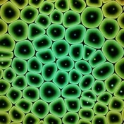

# Bio Lab

Render stylized cell colonies with growth, movement, and competition. The JSON files in `src/scenes/` describe the animations.

[All engines](../README.md) · [Video recipes](../../docs/render-recipes.md)



## Render a scene

With a virtual environment active and ffmpeg installed, run these commands from the repository root.

```sh
cd engines/bio-lab/src
python -m pip install -r requirements.txt
python cli.py render bio --scene scenes/colony_bloom.json --quality 720 --fps 30
```

Try `scenes/v4/vitreous_lanes.json` or `scenes/v4/crimson_delivery.json`. `python cli.py list` shows the scene names. The images are simulations for video.
