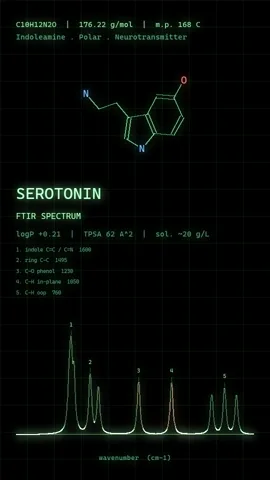
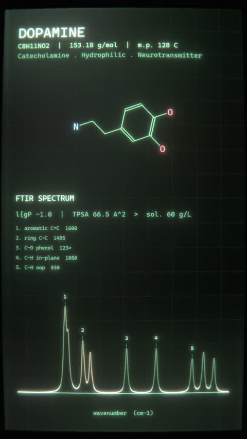
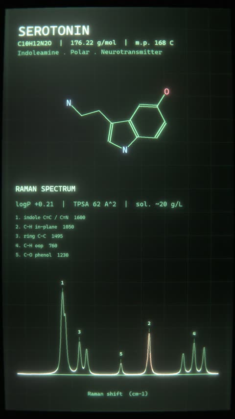
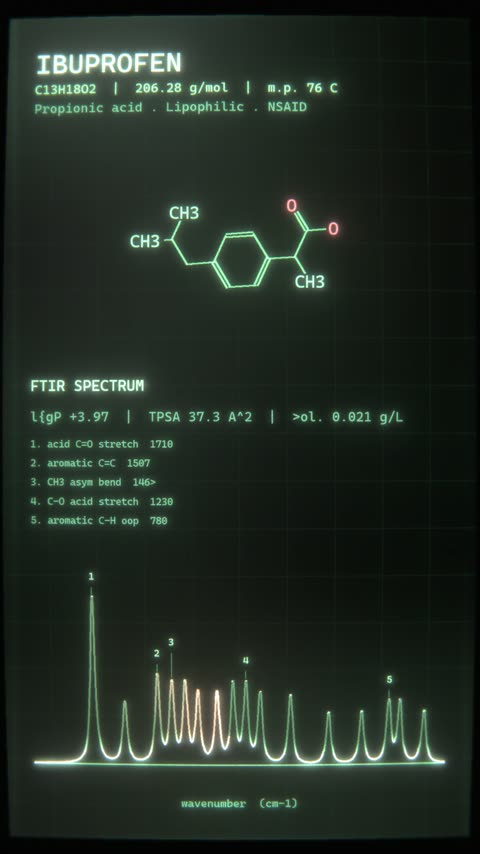
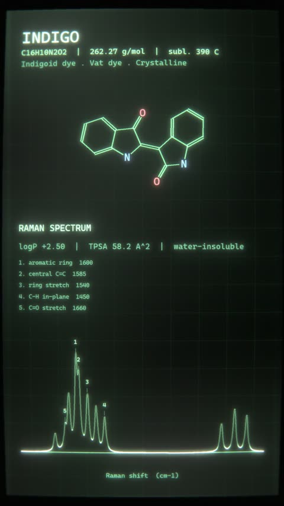

<div align="center">



# Chemical Scope

**29 molecules and their spectra, drawn on a CRT.**

[← All engines](../README.md) · [What it can make](CATALOG.md) · [Stills](frames/README.md) · [Source](src/)

</div>

**Twenty-nine molecules, each with an FTIR and a Raman spectrum, drawn as a CRT oscilloscope
screen.** Molecule above, spectrum below, both stroked as phosphor traces.

<p align="center">
<a href="frames/dopamine_t030.jpg"></a>
<a href="frames/serotonin_t082.jpg"></a>
<a href="frames/ibuprofen_t030.jpg"></a>
<a href="frames/indigo_t082.jpg"></a>
</p>

## Start here

From the repo root, inside a virtual environment:

```bash
pip install -r engines/chemical-scope/src/requirements.txt
```

```python
import sys; sys.path.insert(0, "engines/chemical-scope/src")
from chemical_data import MOLECULES

print(len(MOLECULES), "molecules")
m = MOLECULES["Morphine"]
print(f"{len(m['AT'])} atoms, {len(m['BONDS'])} bonds, {len(m['ir_lines'])} IR lines")
```

Then render one:

```bash
cd engines/chemical-scope/src
python chemical_profile.py Serotonin --preview --flat
python render_optimal.py                          # the whole set, three GPU lanes
```

## Neon molecule drawing kit

The cover uses the flat render above. Omit `--flat` to apply the original glass and camera filter.

The drawing kit is part of this engine: `src/osc/chemscope.py` traces the molecular bonds in
phosphor light, places element and functional-group symbols over the structure, and clears the
bond trace beneath each symbol so the labels stay legible. The runnable `chemical_profile.py`
examples above use that kit with molecules from `src/chemical_data.py`; the frame gallery shows
examples including serotonin, dopamine, ibuprofen, and indigo. This engine uses curated structure
and illustrative spectrum data at render time; RDKit is used by the separate Academia chemistry
tools for molecule generation and analysis.

`render_optimal.py` is the high-quality path. It splits every molecule into frame chunks and
**work-steals** them across three GPU lanes, so idle lanes pick up the next chunk and the tail stays
balanced. The pieces join seamlessly because each chunk warms the phosphor first and the film
filter is indexed on the absolute frame number with a fixed seed.

## The format

Three additive buffers composite over a faint graticule:

1. a **decaying persistence buffer** carrying the spectrum as a scope trace,
2. **`bmol`** — the skeletal bonds,
3. **`tmol`** — the functional-group symbols and all text.

Each gets a half-resolution bloom, then the whole thing goes through the CRT film filter with a
**neutral white phosphor** config, because the content is multi-coloured.

Two methods run in sequence, **FTIR then Raman**, cross-dissolving through the phosphor at the
midpoint.

## The two methods are genuinely different

They used to look identical, and fixing that is the substance of this format.

The same band **positions** are reweighted by selection rules. IR intensity goes with change in
**dipole moment**, so C=O, C–O and S=O are strong; Raman goes with change in **polarisability**,
so C=C, ring breathing and C–C skeletal are strong. The Raman legend is the same diagnostic modes
**reordered** by Raman strength, so the handover visibly re-ranks what matters rather than just
redrawing.

> ⚠️ **These spectra are illustrative.** Group-contribution positions with a heuristic Raman
> reweight — not measured, not DFT. Positions are sound, relative intensities are approximate, and
> only about 600–1900 cm⁻¹ is shown. Do not cite them. For the same chemistry done properly, the
> [academia engine](../academia/) has the real parsers and the DFT paths.

## Four devices worth lifting

**The power-on intro.** The screen flicks on, then an **invisible** vertical line sweeps left to
right. Only where it crosses an object — the spectrum curve, the baseline, a bond — is that slice
lit into the phosphor. The accelerating slice therefore *smears* through persistence into a solid
line, and the traces appear to speed up until solid. Nothing is drawn twice and nothing is faded.

**The handover is a scramble, not a fade.** At the midpoint all lower text ASCII-scrambles for
about a second. A fade reads as an accident; a scramble reads as an instrument changing mode.

**The playhead is a LINE, not a dot.** A short bright red leading segment of the trace sweeps the
curve with a phosphor comet-tail. A dot on a spectrum reads as a cursor; a lit leading segment
reads as acquisition.

**Symbols knock out bonds only.** Each functional-group symbol carries a glyph-sized knockout
ellipse that clears the **bond** buffer and never the graticule — so a letter never sits on a bond
while the grid still shows through behind it. Symbols sit *on* their atom; pushing them further
out moves N and O off their own bonds, which was a real bug.

## 3-D molecules, and the trap in them

Nine of the twenty-nine carry a *z* coordinate and rotate to reveal depth. Two motions:

- **billboard rock** — a bounded left-right rotation, never edge-on. Global: the same amplitude
  and period for every molecule.
- **multi-axis tumble** — continuous rotation on three axes at incommensurate frequencies plus a
  fixed in-plane spin. Scale and centre come from the **sampled tumble envelope**, the union
  bounding box over 96 sampled rotations, so a tumbling molecule never clips or drifts.

⚠️ **A 3-D molecule "moves badly" only when its geometry presents a small ring or a non-flat face
to the camera**, so the rock swings something edge-on and the labels collide. The fix is
orientation, not motion: orient by the **whole-molecule principal plane** so the flattest face
points at the camera and z-variance is minimised. The default rule keys on the aromatic ring,
which is right for scaffolds that *have* a big flat ring — Morphine, Oxycodone, Mitragynine — and
wrong for anything that sprawls off one. Fentanyl went from a z-spread of 6.2 to 3.1 on that fix.

A related hardening: strained bridged cages over-constrain the conformer embedding and fail
outright. The generator falls back by dropping stereochemistry — which is not drawn anyway, so
connectivity and 3-D depth stay valid — re-embedding, and then trying a second force field.

## Adding a molecule

One entry in `MOLECULES`. Geometry can be transcribed by hand or generated from SMILES; either
way, hand-author the IR lines and diagnostic bands from the functional groups. For 3-D, add a *z*
to each atom and pick the orientation rule per the trap above.

Per-molecule tuning is a small dict — draw width as a fraction of the frame and symbol size.
Steroids, tripeptides and alkaloids want roughly 0.62–0.74; long fatty-acid chains want 0.82–0.88.

**Validate the formula.** The generator path for the later batches checks each molecule's computed
molecular formula against a known value as a correctness gate, which is cheap and catches a
mis-transcribed bond immediately.

## The set

Twenty-nine, in five batches — see [CATALOG.md](CATALOG.md) for every one with its formula, atom
and bond counts, and both its FTIR and Raman frame.

| batch | what |
|---|---|
| original | Proline, Ibuprofen, Baclofen, Indigo, Methylene Blue, Sertraline, Morphine, Omeprazole |
| neurotransmitters, hormones, opioids | Dopamine, Serotonin, Adrenaline, Estradiol, Testosterone, Oxycodone, Glutathione, Mitragynine |
| eicosanoids | Prostaglandin E2, Thromboxane A2, Leukotriene B4, Thromboxane B2 — all C/H/O-only mediators of the arachidonic-acid cascade |
| cannabinoids and alkaloids | THC, CBD, THCA, Cocaine, Nicotine |
| controlled substances | MDMA, Fentanyl, Methamphetamine, Alprazolam |

THC and CBD are worth looking at side by side: constitutional isomers, identical formula, and the
clearest demonstration in the set that the same formula is not the same spectrum.

## Layout

The layout is a handful of fractional y-coordinates on the compositor — the two metadata
subtitles, the header bottom, the title, the method top. The molecule zone is the gap between the
header bottom and the method top, and the molecule is centred in it and height-capped. All text
sits above the plot; only numeric peak markers sit in the clear gap above each peak, with
anti-collision lift. Nothing overlaps the trace.

Both the normal and the intro text paths read those same attributes — keep them in sync if you
change one.

## Orientation

Because the layout is fractional rather than absolute, re-proportioning for a landscape frame is
those coordinates plus the per-molecule draw width, not a change to any drawing code. The trace,
the molecule and the text all scale from the frame.

## Relationship to the other engines

This shares its CRT core with the [oscilloscope engine](../oscilloscope/) — the persistence
buffer, the film filter, the config and the GPU backend are the same code. It carries its own copy
so each engine stands alone; if you change one, change both.

The format itself is a remake. The original is [`chemical_profiles/`](../../chemical_profiles/) at the
repository root — the manim `VerticalProfile` scene, which spins the molecule over its NMR
spectra, cross-fades to FTIR, and then plays each vibration mode. These molecule geometries were
transcribed one-to-one from that scene family. Render the manim original to see where the format
came from; this engine is what it became once manim was dropped.

## What is not here

- **The 63 MB of source PDFs and the rendered videos.** The frames are what ship.
- **The RDKit SMILES-to-geometry generators.** They live with the chemistry, in the
  [academia engine](../academia/).
- **Audio.** This format ships silent by design.

---

<div align="center">

**Using this?** Keep the header at the top of any file you copy, and credit the repo:
[how to credit](../../README.md#use-it-in-your-own-stuff).<br>
[← All engines](../README.md) · [Front page](../../README.md)

</div>
