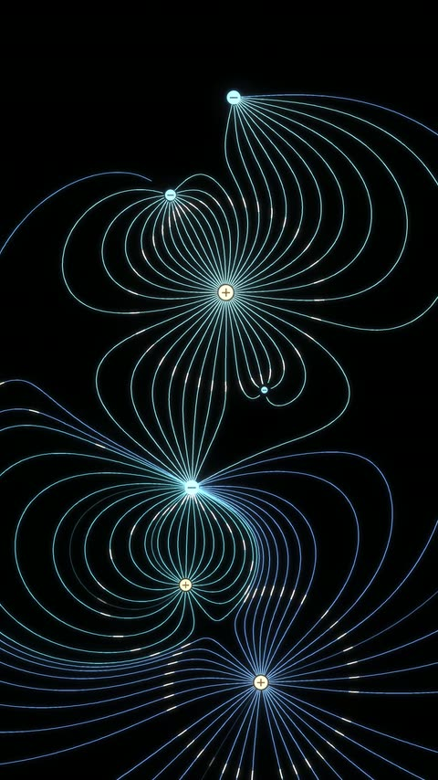
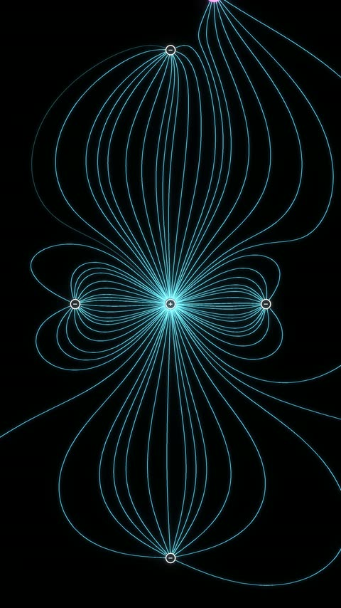
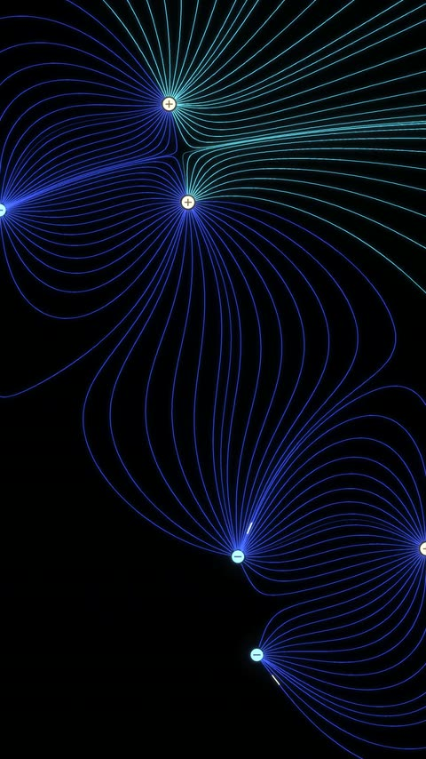
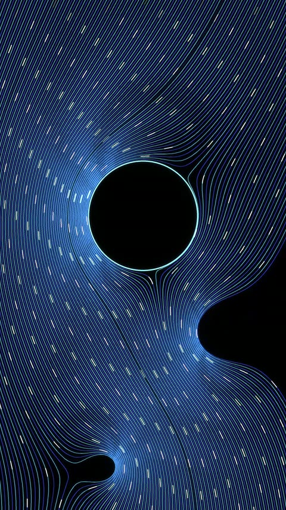

<div align="center">


# Field Lines

**Electric, magnetic and flow fields, drawn as glowing lines.**

[← All engines](../README.md) · [What it can make](CATALOG.md) · [Stills](frames/README.md) · [Source](src/)

</div>

**Field lines and streamlines of a closed-form vector field, integrated in arclength** and drawn
as neon polylines with beat-locked packets riding along them. Electrostatics, potential flow and
magnetostatics all come out of one integrator, because a field here is nothing more than a
callable.

<p align="center">
<a href="frames/charge_wave_t045.jpg"></a>
<a href="frames/dipole_flower_t045.jpg"></a>
<a href="frames/pair_dance_t045.jpg"></a>
<a href="frames/stream_glass_t045.jpg"></a>
</p>

## Start here

From the repo root, inside a virtual environment:

```bash
pip install -r engines/field-lines/src/requirements.txt
```

```python
import sys; sys.path.insert(0, "engines/field-lines/src")
import numpy as np
from fl import field, lines

charges = field.ChargeSet().set([(0., 0.), (0., 300.)], [6.0, -2.0])
seeds   = lines.seed_ring((0., 0.), r0=40., n_max=48)

pts, length, ended = lines.trace(
    charges, seeds, ds=6.0, n_steps=440,
    sinks=charges.sinks(), capture_r=16.0,
    bounds=(-540., 540., -960., 960.))

for code, name in enumerate(lines.END_NAMES):
    print(f"{name:8s} {np.count_nonzero(ended == code)}")
```

That traces the field lines of a +6 and a −2 charge and tells you how each line ended. Swap
`charges` for a `PotentialFlow` and every line above still runs unchanged. That's the whole
design: a field is any callable `f(P) -> V` on an `(N, 2)` array, so adding one changes nothing
downstream.

## Render a video

All five compositions are in `src/fl/scenes.py`:

```bash
cd engines/field-lines/src
python cli.py list
python cli.py dipole_flower --dry                     # flux report, ~2 s, draws nothing
python cli.py dipole_flower --still 0,4,7.5 --preview # PNGs from the same clock
python cli.py dipole_flower --preview                 # 540x960 @30
python cli.py dipole_flower                           # 1080x1920 @60 -> out/dipole_flower.mp4
```

**Run `--dry` first, every time.** It answers the one question a render can't: are the lines
ending where field lines have to end? Tune against it, not against renders. `tools/pf_check.py`
and `tools/dance_check.py` are the two intent checks described below.

## Nothing here solves a PDE

Every field is a closed form evaluated at an array of points. There is no lattice, no timestep, no
CFL condition, and **nothing can diverge** — which is the opposite situation from a real solver,
and it moves all the risk into two places instead:

| risk | where | guard |
|---|---|---|
| a singular source | `coulomb(soft=...)` | Plummer softening; without it an RK4 step that lands near a charge takes a NaN |
| a line that never resolves | `trace` | the fate codes; see below |

A composition may never *place* a field line. Every curve is the integrator's answer. What a
composition legitimately chooses is a source's position, magnitude or sign at time *t*, its
material, a declared forcing, and how many lines are lit — all things a real rig has.

## The three decisions everything rests on

### The step is in ARCLENGTH, and it is constant

Every seed advances by dividing out the field's own magnitude, so the integrator walks the
direction field at unit speed:

$$
\frac{d\mathbf{p}}{ds}\;=\;\frac{\mathbf{E}(\mathbf{p})}{\lVert\mathbf{E}(\mathbf{p})\rVert}
\qquad\Longrightarrow\qquad
\left\lVert \frac{d\mathbf{p}}{ds} \right\rVert = 1
$$

Normalising costs one divide and buys two things:

- drawn line density is uniform instead of piling up wherever the field is weak;
- **every vertex is exactly $\Delta s$ from the last**, so a packet advected at speed $v$ stops
  being an integration at all and becomes an array index,

$$k \;=\; \operatorname{round}\!\left(\frac{v\,t}{\Delta s}\right)$$

That second point is why `pulses.py` is a hundred lines with no integration in it. Do not
"improve" it by integrating markers separately — they desynchronise from the line under them
within a few frames. The mechanism was identified in the first place by noticing that packets hold
a constant *arclength* speed while their *radial* rate falls as the lines curve.

### Seeds are allocated once and lit by ALPHA, never re-spaced

A seed bank holds a fixed set of angles, and `fade_order` lights them in **bit-reversed** order,
so the first *k* for any *k* are quasi-uniformly spread and a new line fades in exactly between two
lines that did not budge. Re-spacing on every integer crossing of an animated line count makes the
whole fan snap — the single most likely visual bug in this format.

### Every line is integrated in LOCKSTEP, and dead lines are compacted out

State is `(N,2)` and the loop is over the arclength index. A per-line Python loop turns about 450
vector operations into 90,000 scalar-ish ones and costs roughly 50×.

## How to verify, and what verification does not tell you

Every line ends one of five ways, and the counts are the diagnostic:

| code | meaning |
|---|---|
| `sink` | captured by a negative source — the normal fate |
| `null` | stalled at a saddle or null point — legitimate, a separatrix |
| `bounds` | reached the frame margin — legitimate, escaping flux |
| `BUDGET` | **ran out of arclength. This is a BUG.** |
| `loop` | closed or spiralling — only possible for a vortex or magnetostatic field |

**Do not raise `n_steps` to make `BUDGET` go away.** It means `capture_r < ds` (the line stepped
straight over its sink) or the bounds are wrong — or, in one real case, that the arclength budget
did not clear a straight bounds traverse with slack, so any meander ran out. 2,795 px allowed for
a 2,130 px straight run put 34% of lines out of budget.

**But the fate report only answers "are the lines legal?"** Anything with an intent needs a check
that measures THAT intent. The most valuable one written for this engine asked *is a cylinder
actually a cylinder* by measuring surface-normal velocity directly — see the next section for why.
Two of them ship in `src/tools/` (`pf_check.py`, `dance_check.py`); write the equivalent for any
composition of your own whose success is not simply "it did not crash".

## Two results worth knowing before you build a potential flow

**A doublet built for the wrong stream direction stops being a streamline surface.** One
composition ran its stream along +y with the doublet axis left at +x, and the flow poured
*straight through* the body — measured `max|v·n| = 1.414|U|` on the surface, and 52% of
streamlines "captured" inside a body that potential flow can never let them enter. `cylinder()`
now derives its axis from the stream and never takes it as a parameter.

**One doublet per body is exact only for an ISOLATED body.** Two cylinders in one flow each
violate the other's boundary condition — measured `max|v·n| = 0.81|U|` on a two-body layout whose
doublets alone contribute 0.05, because the **bound vortices** dominate the cross-talk. It is not
fixable by moving them apart or turning circulation down without losing the Magnus effect that was
the point. The fix is **one** cylinder plus Milne-Thomson images of every external singularity,
which is exact for arbitrary external flow: **0.81 → 0.0005**.

## Four more things that cost time

- **Bloom, not the density term, is what washes out a dense bundle.** 210 near-parallel lines
  cover a third of the frame in lit pixels, and a wide halo over that integrates to a flat field
  with no contrast anywhere. A radial fan leaves most of the frame black and wants the same halo
  at full strength. There is no single right exposure for both bundle geometries — hence the
  per-composition glow multipliers.
- **A synchronous pulse is right on a RADIAL bundle and wrong on a PARALLEL one.** Packets at
  equal arclength from a common source form an expanding ring; the same packets on an inlet rake
  stay collinear and sweep as a solid bar that reads as a scan artefact. That is what `stagger` is
  for.
- **Pillow rounds stroke widths to integers, so a preview can lie about a final.** A width of 1.7
  becomes 2 px at half resolution and 3 px at full — 0.00185 of frame width against 0.00139, so
  the final comes out 25% finer and darker than the preview promised. **Use even world widths.**
- **A rake has to be wider than the frame.** At a modest stream tilt a 2,000 px descent drifts a
  streamline about 320 px sideways, so a rake that only just covers the frame leaves the
  downstream third black. Overhang both edges past the worst drift and accept that a large
  fraction of the lines are off camera.

## Performance

Measured on an RTX 2060 / i7-9700K. The bottleneck is **Pillow vector rasterisation**, not array
maths, so there is no GPU path and no need for one yet. Three lanes is the NVENC ceiling.

| | 540×960 @30, 15 s | 1080×1920 @60, 15 s |
|---|---|---|
| a radial electrostatic composition | 64–71 s | ~7–9 min |
| a dense parallel bundle | 145 s | ~16 min |

The dense case is roughly twice the others because its lines are the longest and none of them
terminate early.

## Orientation

Nothing in the fields, the integrator or the pulses knows about aspect ratio — only `draw.Frame`
and `RenderConfig` do. A landscape plate is a different frame size and different seed geometry.
The one thing to re-derive is the arclength budget, since it must clear a bounds traverse.

## What is not here

- **The horizontal stock set.** The 16:9 versions I sell as stock footage stay with me; the five
  vertical compositions are all here.
- **Audio.** The format is built for it — the packet period is already one bar at 96 BPM, and line
  count and source magnitude are exactly the channels a track should drive — but nothing is wired
  up. The keep-them-equal rule if you add it: build `start` must equal mux `-ss`.

---

<div align="center">

**Using this?** Keep the header at the top of any file you copy, and credit the repo:
[how to credit](../../README.md#use-it-in-your-own-stuff).<br>
[← All engines](../README.md) · [Front page](../../README.md)

</div>
