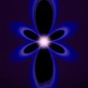

# Orbital Lab

Watch orbital shapes morph as the camera moves around them. The scene presets include the main orbital sequence, dot fields, and molecular orbitals.

[All engines](../README.md) · [Video recipes](../../docs/render-recipes.md)



## Render a scene

With a virtual environment active and ffmpeg installed, run these commands from the repository root.

```sh
cd engines/orbital-lab/src
python -m pip install -r requirements.txt
python cli.py render qm_orbitals --tier preview
```

Try `qm_dots`, `qm_full_morph`, or `mol_ice`. Use `python cli.py list` to browse the rest. The two music scenes read their timing from the included session file and require a copy of the source audio at `audio/4morant.wav`.
