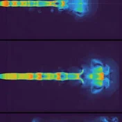

# Plume Lab

Compare how exhaust plumes look as the surrounding pressure changes. Scene presets include single plumes, side by side comparisons, and a schlieren view.

[All engines](../README.md) · [Video recipes](../../docs/render-recipes.md)



## Render a scene

With a virtual environment active and ffmpeg installed, run these commands from the repository root.

```sh
cd engines/plume-lab/src
python -m pip install -r requirements.txt
python cli.py render triple_altitude --width 540 --height 960 --fps 15 --seconds 2
```

Remove the size, frame rate, and duration overrides to use the scene defaults. Try `plume_triple`, `plume_under`, or `plume_schlieren`. `python cli.py list` shows the available scenes.
